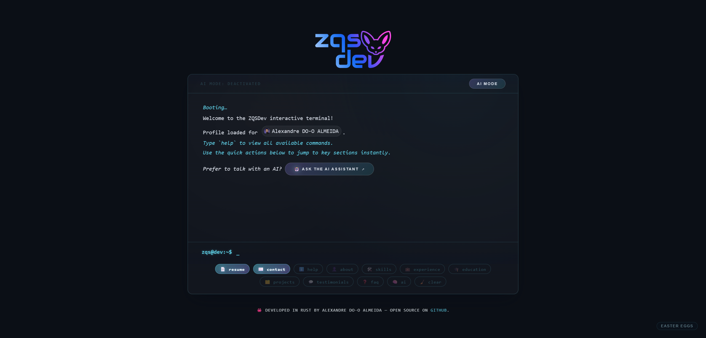

# 🖥️ ZQS Terminal — Rust Résumé in Your Browser
  

An immersive single-page web terminal that reveals Alexandre DO-O ALMEIDA’s résumé through typed commands. Everything is written in **Rust**, compiled to WebAssembly, and ships as a framework-free SPA for fast cold starts.



## ✨ Features
- 🎛️ Web-only terminal UI with history, autocomplete, theming, achievements, and an **AI Mode** toggle.
- 📦 Static résumé data sourced from JSON so updates never require a recompile of the terminal.
- 🤖 Optional AI concierge served by a Rust Cloudflare Worker (`zqsdev-api`) that uses complete curated knowledge and persistent spending limits kept in a SQLite Durable Object.
- 🚀 Build pipeline ships optimized WebAssembly + minified CSS in `static/`, served by the `zqsdev` site Worker on Cloudflare.

## 🤖 AI Concierge Stack
- Generation: one OpenAI `gpt-6-luna` call, Chat Completions with reasoning `none` and a 640-token output cap.
- Knowledge: all seven curated JSON sources, including expanded projects, publications, awards and testimonials beyond the one-page CV, embedded in the API Worker at build time. No paid retrieval or vector database is needed.
- Follow-ups: the last three exchanges are kept in tab memory, bounded and validated by the API. `quit` or refresh clears them.
- Reliability: pre-call rate/concurrency limits, one 16-second budget per question (responses within 17.5 s), a 20-second browser deadline and a working classic terminal on failure.
- Spending: persistent ledger in a Durable Object, conservative reservation followed by one reconciliation against reported input/output/cache usage. $0.50/minute, $2/hour and day, $10/30 days and 2,000 calls per day by default.
- Attribution: `sources` contains validated section IDs, shown below each answer. Factual evaluation remains necessary; metadata alone does not establish correctness.

## 🗂️ Repository Layout
```
.
├── Cargo.toml            # Frontend crate manifest (workspace root; api/ is excluded)
├── VERSION               # Project version (sync via scripts/bump_version.py)
├── Makefile              # Build/test/deploy entry points (wasm-pack, Cloudflare)
├── site-rules.json       # Redirects, rewrites and cache headers for every zqsdev.com host
├── worker/index.js       # Site Worker applying site-rules.json in front of static/
├── wrangler.jsonc        # Site Worker config (assets, routes, API service binding)
├── .env.example          # Optional Pushover keys for the smoke test
├── src/                  # Rust/WebAssembly terminal (commands, state, renderer)
├── api/                  # zqsdev-api Worker: Rust (workers-rs), /api/* + Ledger Durable Object
│   ├── wrangler.jsonc    # API Worker config (vars, secrets, Durable Object)
│   ├── .dev.vars.example # Local secrets template for wrangler dev
│   └── src/              # core/ (pure, natively tested) and glue/ (Workers runtime)
├── static/
│   ├── index.html        # Terminal shell + module bootstrap
│   ├── style.css         # Source stylesheet (minified to style.min.css)
│   ├── style.min.css     # Minified styles generated by make build
│   ├── data/             # Résumé JSON (profile, skills, experience, education, projects)
│   ├── images/           # Logos & Open Graph artwork
│   ├── icons/            # Favicons & manifest assets
│   ├── effects/          # Visual flourish assets (canvas, particles, etc.)
│   ├── cv/               # Canonical HTML resume, PDF download and local assets
│   └── pkg/              # wasm-bindgen output mirrored from /pkg
├── pkg/                  # Raw wasm-pack artefacts (ignored by git)
├── scripts/
│   ├── bump_version.py   # Bumps VERSION + Cargo.toml
│   ├── live_smoke_test.py  # Production smoke test (nightly in GitHub Actions)
│   ├── zqs_admin.py      # Admin client for the API ledger (stats, export, import, purge)
│   ├── verify_api_deploy.py  # Post-deploy check of the API Worker, with rollback
│   ├── verify_cutover.py # One-off real-path checks of the cut-over (visitor IP, settlement)
│   ├── test_api_local.py # Local end-to-end test of both Workers
│   ├── openai_stub.py    # Local stand-in for OpenAI
│   ├── minify_css.py     # CSS minifier invoked by make build
│   └── serve.py          # Static dev server (writes server.log)
├── .github/workflows/    # Nightly live smoke test
└── screenshot_zqsdev.png # README showcase image
```

## 🚀 Quick Start
Install the prerequisites once:
```bash
rustup target add wasm32-unknown-unknown
cargo install wasm-pack
```

Fetch dependencies and build the terminal bundle:
```bash
make build
```

## ⌨️ Commands
Inside the terminal, try:

```
help        about       skills       experience
education   projects    testimonials contact
faq         resume      theme        ai
clear
```

Flip on **AI Mode** with the toolbar button to ask natural-language questions. When disabled, helper chips provide quick access to the commands above.

## 🛠️ Development Workflow

```bash
# 1. Compile the WebAssembly bundle (writes static/pkg/)
make build

# 2. Static-only dev server (no API, logs to server.log)
make serve-static                   # http://localhost:8765 by default
make serve-static STATIC_PORT=9000
```

`make build` always refreshes `static/pkg/` and `static/style.min.css`, both of which must ship alongside the rest of `static/` for deployment.

### 🧪 Local development of the full stack
Prerequisites: `rustup target add wasm32-unknown-unknown`, wrangler 4.156.0 (`npx wrangler`), Python 3. The API build installs `worker-build@0.9.0` itself. Copy `api/.dev.vars.example` to `api/.dev.vars` (git-ignored); its `ADMIN_TOKEN` is empty, which keeps `/api/admin/*` disabled until you paste a generated token of at least 32 characters.

Offline, with no OpenAI cost, in three terminals:

```bash
make dev-stub    # python3 scripts/openai_stub.py --port 9911
make dev-api     # cd api && npx wrangler dev --local --port 8788 --var OPENAI_BASE_URL:http://127.0.0.1:9911/v1
make dev-site    # npx wrangler dev --local --port 8787 --infer-origin-from-routes=false
```

The site's `API` service binding connects to the local API session: open `http://127.0.0.1:8787`. The API keeps its Durable Object SQLite under `api/.wrangler/`. With `DEV_API_FLAGS=` the API calls the real OpenAI with the key of `api/.dev.vars` (about $0.0005 a question). Note that wrangler also reads `OPENAI_API_KEY` and `ADMIN_TOKEN` from your shell environment, and those values win over `api/.dev.vars`. `make dev` runs both Workers in one experimental multi-config session (without the stub: AI then calls the real OpenAI).

`make test-api-local` (or `python3 scripts/test_api_local.py`) starts the stub and both Workers itself, checks every route through the binding (visitor IP, slots, timeout, transactionSync rollback, admin operations, the 502 of a disconnected binding) and stops everything.

## 📚 Curated knowledge
Edit `static/data/*.json`, run `python3 scripts/validate_knowledge.py`, then `make build && make test`, commit, push (the site serves the JSON files) **and** run `make deploy-api`: the API embeds the knowledge and the `/api/data` body at build time. `KNOWLEDGE_UPDATED` is `updated_at` from `profile.json`; bump it when the data is reviewed. The reviewed full-context ceiling is 64 KB and the API build fails beyond it. Builds require no AI credentials.

The migration verified all 44 live SQLite chunks against the JSON sources and the Pinecone index held 44 vectors. All original projects (including Micro Mages, Mistale, BeeToBee and TheClair), education, publications, awards and two full testimonials were preserved. The obsolete terminal-project description, role dates and availability FAQ were updated; Studi and agentic engineering were added.

Legacy `build_rag.py`, `inspect_rag.py` and `make rag` remain available for historical inspection only. Normal build and runtime never query Pinecone, call embeddings or open SQLite. The old index is left intact.

Official model reference: [GPT-6 Luna](https://developers.openai.com/api/docs/models/gpt-6-luna). Rates checked on 2026-11-24: input $0.10, cache read $0.01, cache write $0.125, output $0.50 per million tokens. `gpt-5.6-luna` keeps built-in prices for a rollback; any other model needs all four `AI_*_USD_PER_MILLION` vars in `api/wrangler.jsonc`.

## ✅ Tests & Quality Gates

```bash
make test   # Python suites + wasm-pack test --node + cargo test for the API Worker
make fmt    # cargo fmt for the frontend and api/
make check  # cargo check (wasm32) + clippy -D warnings for the API Worker
make api-dry-run      # build and validate the API Worker without uploading
make test-api-local   # local end-to-end test of both Workers
```

The CI pipeline should run the same trio so local runs stay in lockstep with automation.

## 🩺 Live Production Smoke Test

Run `make autotest` (or directly `python3 scripts/live_smoke_test.py`) to exercise the deployed site once end-to-end. It validates the deployed bundle, the `/api/version`, `/api/health` and `/api/data` endpoints, and sends two questions to the AI concierge. Install the lone dependency with `pip install requests`. Optional flags:

```bash
python3 scripts/live_smoke_test.py --json-output live-smoke.json
python3 scripts/live_smoke_test.py --ai-question "What's new with Alexandre?"
python3 scripts/live_smoke_test.py --api-base-url https://zqsdev-api.aleqsd.workers.dev   # API canary
# Or via make (flags are forwarded):
make autotest AUTOTEST_FLAGS="--json-output live-smoke.json"
```

The script exits non-zero on failure so monitors can trigger alerts. Keep the two-question smoke suite bounded to respect the production rate limits. The GitHub Actions workflow `.github/workflows/live-smoke.yml` runs it every night at 07:30 UTC.

If `PUSHOVER_API_TOKEN` and `PUSHOVER_USER_KEY` are present (in the environment, `.env.local`, or `.env`; repository secrets for the workflow), the script sends a Pushover alert only when a check fails or the run ends early with skipped tests. Disable that behaviour with `--no-pushover` or `AUTOTEST_FLAGS="--no-pushover"` if needed.

## 🔑 Secrets and Variables

- The API Worker's secrets are `OPENAI_API_KEY` and `ADMIN_TOKEN` (at least 32 characters). Set them in Cloudflare from `api/` with `printf '%s' "$OPENAI_API_KEY" | npx wrangler secret put OPENAI_API_KEY`; never commit them. For local development they go in `api/.dev.vars` (see `api/.dev.vars.example`).
- Its vars (model, budgets, daily caps, log retention, text budget, daily delete budget, log level) live in `api/wrangler.jsonc` and are validated by a test before every deploy. The delete budget (`LOG_DELETE_DAILY_ROWS`) bounds the rows that admin purges and log retention delete per UTC day: deletes count as Durable Object rows written, whose Free quota is shared by the whole account.
- `.env.example` only lists the optional Pushover keys of the smoke test; `.env` and `.env.local` are ignored by git.
- No other AI provider or vector-database credentials are needed.

## 📦 Versioning & Release Workflow
- ✅ Run `make build` and `make test` before handing changes off so `static/pkg/` and the API Worker both stay green.
- ⬆️ Bump the version with `python3 scripts/bump_version.py` (touches `VERSION` and `Cargo.toml`; the API reads `VERSION`). The script defaults to patch releases; pass `minor` or `major` when needed.
- ✍️ Commit only the sources, regenerated assets under `static/pkg/`, and version bumps. Artifacts in `/pkg`, local env files, and logs (`server.log`) are ignored by default.

## 🎨 Customising the Résumé
- 🔗 The public resume is `https://cv.zqsdev.com/`. The terminal uses this same canonical CV, in English and French.
- 🧾 Edit the JSON files in `static/data/` to refresh profile details, experiences, and skills for the interactive terminal and AI knowledge base.
- 📄 Edit `static/cv/index.html` (English), `static/cv/fr.html` (French) and the shared `static/cv/resume.css` for the public resume. The approved base V4 is available as `resume.pdf` in English and `resume-fr.pdf` in French. Each static page links to its matching PDF and the other language, including without JavaScript. `resume.js` localizes the clipboard message, preserves terminal return context when switching language and fits the document inside the original PDF frame.
- 🖨️ After editing the HTML, regenerate both PDFs with `python3 scripts/render_cv_pdfs.py` (headless Chrome + PyMuPDF; `--check` only prints the text diff).

## 🚢 Deployment
Two Cloudflare Workers on the Free plan: the `zqsdev` site Worker (JavaScript, static assets) and the `zqsdev-api` Worker (Rust), joined by a service binding.

### ☁️ Site Worker (zqsdev.com and its subdomains)
- 🌐 Since 2026-11-01 the site is a Cloudflare Worker with static assets (`wrangler.jsonc`, `worker/index.js`); DNS for `zqsdev.com` is on Cloudflare too. Workers Builds deploys `main` on every push (`npx wrangler deploy`, no build step: commit the built `static/`).
- 🗺️ `site-rules.json` holds every redirect, rewrite and header rule; `worker/index.js` applies them in order. It serves the HTML resume at `cv.zqsdev.com`; `founding.zqsdev.com`, `devops.zqsdev.com`, `software.zqsdev.com` and their old PDF links redirect to it. `calendly.zqsdev.com` still forwards to Calendly. Keep the legacy domain aliases so existing shared links continue to work.
- 🔁 `/api/*` requests go through the `API` service binding to the `zqsdev-api` Worker, same-origin for the browser; the call is kept alive with `ctx.waitUntil` if the visitor disconnects. The API Worker must exist before a site deploy that declares the binding.
- 🚀 Manual deploy: `make deploy` (runs `make build` then `npx wrangler deploy`; needs `npx wrangler login` once); from Windows, use a checkout with `core.autocrlf=false` so text assets keep LF endings. `make deploy-preview` serves the Worker locally with `wrangler dev`; send `x-test-host: cv.zqsdev.com` to act as another host.
- 🧭 Each hostname is a Worker route in `wrangler.jsonc` on a proxied DNS record. A new subdomain needs both.

### 🦀 API Worker (zqsdev-api)
- 🧱 `api/` is a workers-rs 0.9.0 crate: the fetch handler serves `/api/data`, `/api/version`, `/api/health`, `/api/ai`, `/api/log/command` and `/api/admin/*`; one SQLite Durable Object (`Ledger`) holds the spend ledger, the rate-limit windows, the provider slots and the question, answer and command logs.
- 🚀 Workers Builds has no Rust toolchain, so the API is deployed from a developer machine: commit, then `make deploy-api` (tests including the committed config, `wrangler deploy`, then `scripts/verify_api_deploy.py`, which rolls back automatically when `/api/version`, `/api/health` or `/api/data` is wrong). `make api-dry-run` builds without uploading.
- 🩺 `https://zqsdev.com/api/health` answers `{"ok":true,…}` for an uptime monitor; `make api-tail` streams the Worker logs; `python3 scripts/zqs_admin.py stats` reads the ledger (admin token from `ZQS_ADMIN_TOKEN` or a prompt).
- 🔐 The API has no public route: it is reached only through the site's binding (`workers.dev` stays on only for the canary and the soak).

---

Built with 🦀 Rust and ❤️ by Alexandre DO-O ALMEIDA (ZQSDev). Enjoy the terminal! 🙂

### Public CV assets

The V4 content is ordinary semantic HTML, in English and French; each language has a matching one-page PDF. These are translations of the same CV, not different role variants.
The original dark shell, rounded toolbar buttons and `.page` frame are preserved. On narrow screens the HTML reflows for reading, while printing preserves the A4 layout.
Run `python3 -m unittest scripts.test_cv_site` to check the static CV and routing contracts.

Portrait: final 1254x1254 PNG supplied by Alexandre on 2026-09-08, published without further editing. The HTML and PDF use the same image.
Studi logo: [Studi, Wikimedia Commons](https://commons.wikimedia.org/wiki/File:Studi_logo.svg), [CC BY 4.0](https://creativecommons.org/licenses/by/4.0/), unmodified.
PlayStation symbol: official PlayStation site. YC badge: typographic Y.
Token Tracker icon: bolt and background layers from the [official app icon](https://github.com/xiufengsun/TokenTracker/tree/main/TokenTrackerBar/TokenTrackerBar/AppIcon.icon/Assets) (MIT), combined into one rounded SVG on 2026-10-17; links to [Aleqsd's public profile](https://www.tokentracker.cc/u/ad7485bd-6569-45a5-850d-44a9de505b1b).

Toolbar: monochrome GitHub and LinkedIn SVG marks inherit the light text color to stay legible on the dark background. Language flags are decorative SVGs with visible language names.
